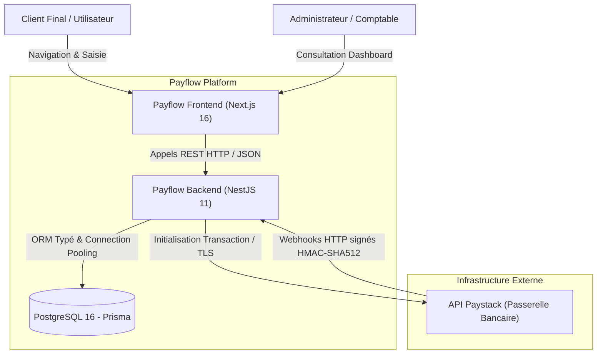
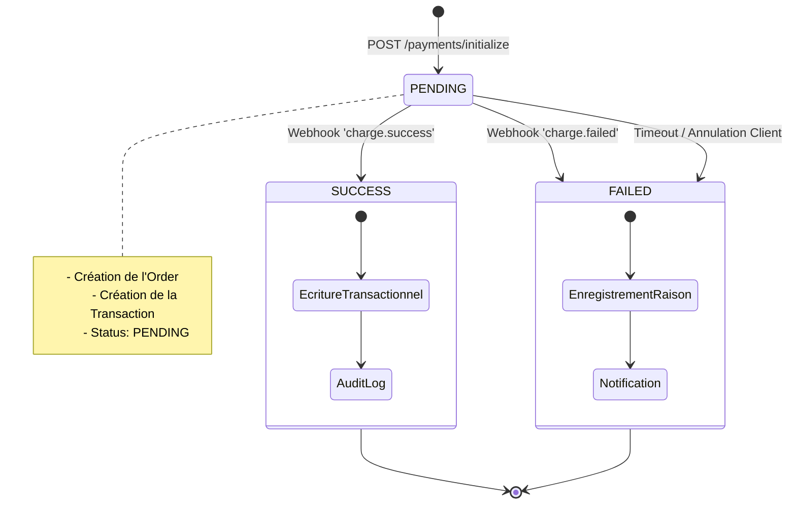
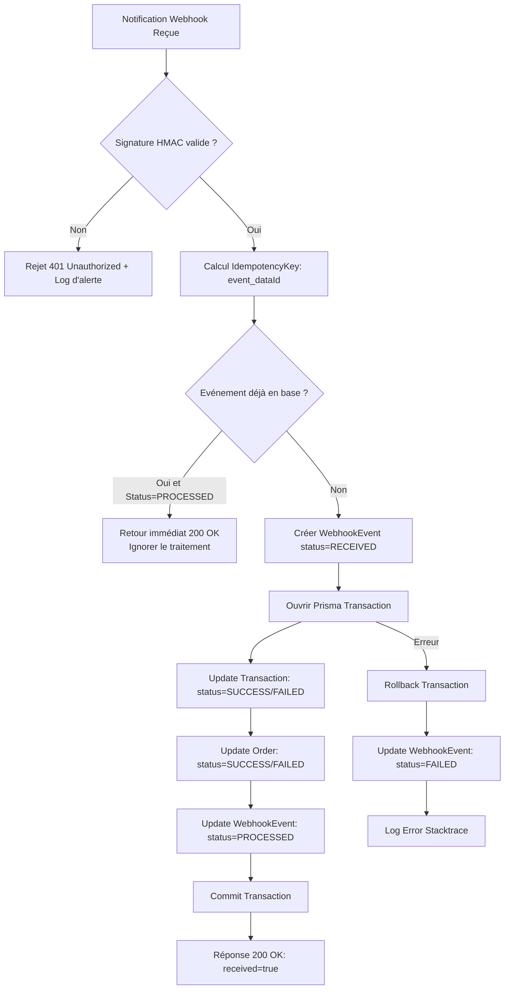

# 🏛️ Architecture Technique — Payflow Backend

Ce document décrit l'architecture système, les choix techniques fondamentaux, les mécanismes de sécurité et les flux de données du backend **Payflow**.

---

## 1. Vue d'Ensemble du Système (C4 Container Diagram)

Le système Payflow assure l'interface sécurisée entre le frontend web, la base de données relationnelle et l'agrégateur bancaire Paystack.



---

## 2. Découpage Modulaire & Architecture en Couches

L'application repose sur le pattern architectural modulaire de NestJS, garantissant une séparation stricte des responsabilités (Separation of Concerns) et une testabilité unitaire totale :

```
┌────────────────────────────────────────────────────────┐
│                   Contrôleurs HTTP                     │
│  (PaymentsController, TransactionsController, etc.)    │
└───────────────────────────┬────────────────────────────┘
                            │ ValidationPipe (class-validator)
┌───────────────────────────▼────────────────────────────┐
│                  Couche Métier / Services              │
│  (PaymentsService, WebhooksService, PaystackService)   │
└───────────────────────────┬────────────────────────────┘
                            │ Inversion de contrôle
┌───────────────────────────▼────────────────────────────┐
│              Couche d'Accès aux Données (Prisma)        │
│          (PrismaService, Adapteur pg, Migrations)       │
└───────────────────────────┬────────────────────────────┘
                            │ Connexion sécurisée
┌───────────────────────────▼────────────────────────────┐
│                 Base de Données PostgreSQL             │
└────────────────────────────────────────────────────────┘
```

### Rôle des modules :
- **`PaymentsModule`** : Orchestre l'initialisation des transactions. Responsable de la génération des références uniques, du calcul des montants en sous-unités monétaires (centimes), et de la création coordonnée de la commande (`Order`) et de la transaction initiale.
- **`PaystackModule`** : Client HTTP encapsulé chargé des échanges sortants avec l'API Paystack (`https://api.paystack.co`). Il injecte automatiquement les jetons d'autorisation Bearer et configure les URL de redirection callback.
- **`WebhooksModule`** : Hub d'ingestion asynchrone des événements de paiement. Il gère la sécurité cryptographique, l'idempotence et les mutations d'état de la base de données.
- **`TransactionsModule`** : Fournit une interface de lecture (Query Service) optimisée pour le grand livre des transactions et les détails individuels.
- **`PrismaModule`** : Gère le cycle de vie du pool de connexions à PostgreSQL (`$connect`, `$disconnect`).

---

## 3. Cycle de Vie d'un Paiement & Machine à États

Chaque tentative de transaction traverse une série d'états immuables garantissant la traçabilité financière :



### Règles de transition :
1. Une transaction est créée au statut `PENDING`.
2. Seul un webhook signé et vérifié émis par Paystack peut faire basculer le statut vers `SUCCESS` ou `FAILED`.
3. Une fois dans un état terminal (`SUCCESS` ou `FAILED`), le statut devient immuable : aucun événement ultérieur ne peut rétrograder une transaction réussie.

---

## 4. Sécurité & Moteur d'Idempotence des Webhooks

Les webhooks de passerelles de paiement peuvent être retransmis plusieurs fois (at-least-once delivery) par le réseau. Le moteur de traitement de Payflow applique un algorithme de déduplication strict :



---

## 5. Modélisation de Données & Indexation

Le schéma Prisma (`schema.prisma`) applique les meilleures pratiques pour supporter une charge élevée en lecture et en écriture :

- **Identifiants UUID v4** : Évitent l'énumération séquentielle des identifiants et sécurisent les URL contre le scraping.
- **Index composites et simples** :
  - `Order(reference)` : Recherche instantanée lors du callback de redirection.
  - `Transaction(internalRef)` : Réconciliation directe lors de la réception des webhooks.
  - `Transaction(status, createdAt)` : Accélération des requêtes d'agrégation et de filtrage pour le Dashboard.
  - `WebhookEvent(idempotencyKey)` : Vérification d'unicité en `O(1)`.

---

## 6. Stratégie de Résilience & Observabilité

1. **Gestion des Erreurs Normalisée** : Toutes les erreurs HTTP renvoyées par l'API respectent la structure RFC 7807 (via NestJS `HttpExceptionFilter`).
2. **Sanitization des Logs** : Les secrets, numéros de cartes de crédit et clés API sont exclus des sorties console.
3. **Health Check Probe (`/health`)** : Vérification immédiate de disponibilité pour les outils de supervision (Pingdom, BetterUptime, Datadog, Prometheus).
