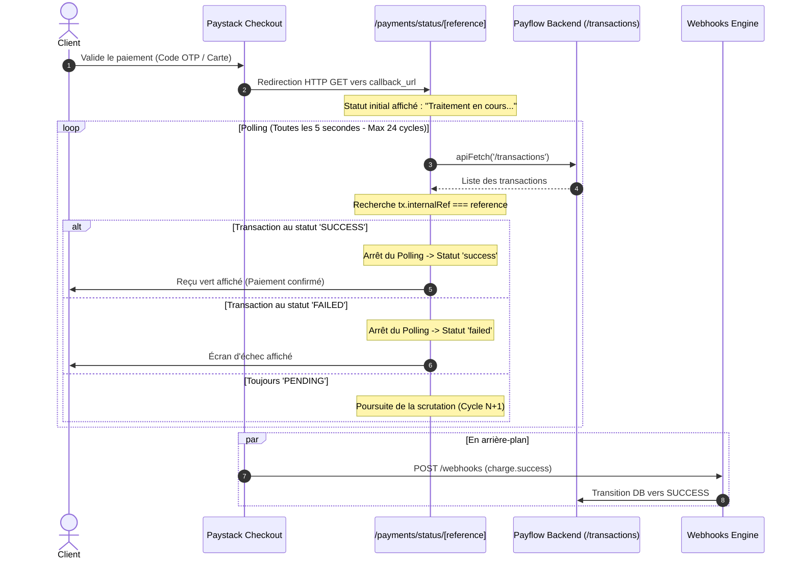

# 🏛️ Architecture Technique — Payflow Frontend

Ce document décrit l'architecture frontend, les choix de conception des composants, les flux de données et la stratégie d'état de **Payflow Frontend**.

---

## 1. Vue d'Ensemble & Arborescence des Composants

L'application utilise le modèle **App Router** de Next.js 16, associé à une hiérarchie de composants hautement modulaires :

```
RootLayout (src/app/layout.tsx)
 └── AppLayout (src/components/AppLayout.tsx)
      ├── Sidebar (src/components/Sidebar.tsx) — Navigation principale, routes actives
      ├── Header (src/components/Header.tsx) — Recherche globale, profil, notifications
      └── Main Content Area (Page Router)
           ├── Dashboard Page (/)
           │    ├── StatCard (x4) — Métriques financières agrégées
           │    └── RecentActivity — Flux chronologique
           ├── New Payment Page (/payments/new)
           │    └── FormField (x5) + Sélecteur de méthode (Card / MoMo)
           ├── Payment Status Page (/payments/status/[reference])
           │    └── Poller Engine + Reçu transactionnel
           ├── Transactions Ledger (/transactions)
           │    └── Table filtrable + StatusBadge
           └── Webhooks Console (/webhooks)
                └── WebhookStatusBadge + EventTag + Inspecteur JSON
```

---

## 2. Frontière Client / Serveur (Client vs Server Boundaries)

Next.js 16 privilégie les Server Components par défaut. Cependant, pour une application financière dynamique nécessitant des interactions en temps réel, Payflow utilise une séparation claire :

- **`RootLayout` (`layout.tsx`)** : Server Component pur. Il configure les métadonnées SEO (`title`, `description`), les polices typographiques (`Geist`), et charge les feuilles de styles globales.
- **Pages Applicatives (`"use client"`)** : Toutes les pages métier (`/`, `/payments/new`, `/transactions`, etc.) sont des Client Components car elles gèrent :
  - L'état local réactif (`useState`, `useEffect`).
  - La gestion des événements de formulaire et la validation immédiate.
  - Le polling asynchrone pour la confirmation des paiements.
  - La navigation programmatique via `useRouter` et la lecture des paramètres d'URL dynamiques (`useParams`).
- **`export const dynamic = 'force-dynamic'`** : Utilisé sur les pages transactionnelles pour empêcher le pré-rendu statique obsolète lors du build et forcer l'évaluation dynamique côté client.

---

## 3. Moteur de Polling Réactif (Payment Status Flow)

Lorsqu'un utilisateur final effectue un paiement sur l'interface sécurisée de Paystack, il est redirigé vers `/payments/status/[reference]`. À ce moment précis, le webhook de confirmation peut être en cours de transit réseau.

Le frontend implémente un algorithme de scrutation (polling) non bloquant :



### Caractéristiques du polling :
- **Fréquence** : 5 000 ms.
- **Plafond de sécurité** : 24 tentatives (2 minutes). Au-delà, un statut d'expiration convivial est présenté sans bloquer l'interface.
- **Nettoyage automatique** : `clearInterval` est invoqué lors du démontage du composant (`useEffect cleanup`) pour éviter toute fuite de mémoire.

---

## 4. Couche d'Accès Réseau (`src/lib/api.ts`)

Pour éliminer la redondance et garantir un traitement homogène des erreurs :

```typescript
export const apiFetch = async (endpoint: string, options: RequestInit = {}) => {
  const url = `${API_URL}${endpoint}`;
  // Injection automatique des headers JSON
  // Gestion uniforme des réponses vides (204) et des payloads JSON
  // Normalisation des messages d'erreur du backend (Array ou String)
};
```

### Tolérance aux pannes réseau :
Si le serveur distant est éteint (`ECONNREFUSED` ou `Failed to fetch`), le client intercepte l'exception et permet aux composants de basculer en mode de dégradation élégante (fallback UI).

---

## 5. Système de Design & Tokens CSS (Tailwind v4)

Le frontend intègre **Tailwind CSS v4** avec une architecture de design tokens inspirée du design d'entreprise moderne :

```
globals.css
 └── @theme
      ├── Couleurs de marque : --color-primary (#5427e6)
      ├── Surfaces & Containers : --color-surface (#f4f5fb), --color-surface-container
      ├── Sémantique financière :
      │    ├── Succès : --color-secondary (#006e2f)
      │    ├── En attente : --color-tertiary (#794b00)
      │    └── Échec : --color-error (#ba1a1a)
      └── Typographie : Inter & Geist sans-serif
```

Tous les composants partagent les mêmes classes utilitaires pour assurer une cohérence visuelle parfaite sur mobile, tablette et grand écran (Responsive Design).
